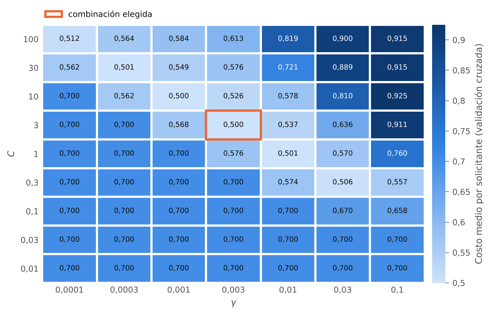
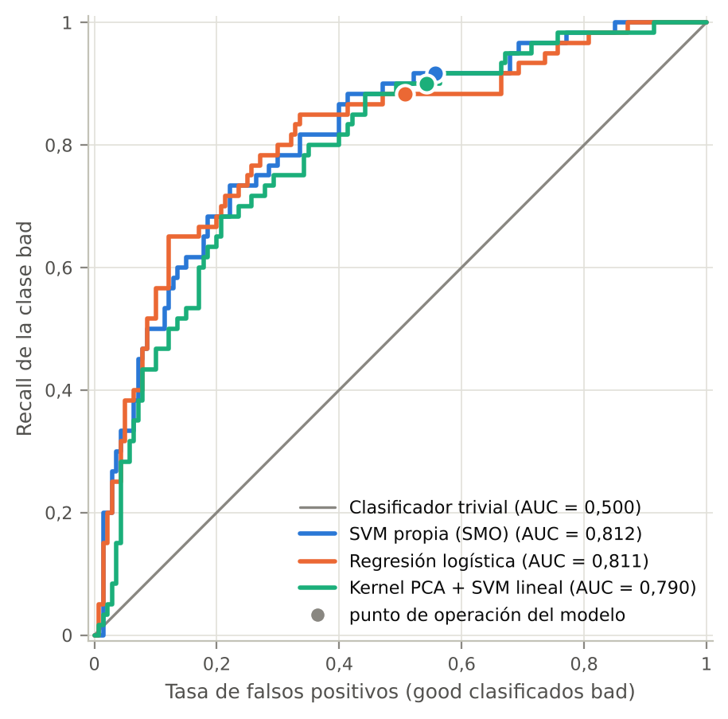

# RKHS-Model — riesgo crediticio con métodos de kernel

[](https://github.com/eliasrubil/RKHS-Model/actions/workflows/tests.yml)

Clasificador de riesgo crediticio sobre **German Credit (Statlog)** construido con métodos de
kernel (RKHS):

- **Kernels componibles** (lineal, RBF, polinomial; `k1 + k2`, `k1 * k2`, `a * k`).
- **SVM de margen suave** resuelta en el dual con **SMO**, con pesos por clase para el costo
  asimétrico.
- **Kernel PCA** para estudiar la estructura no lineal y como etapa opcional del pipeline.

Las tres piezas están implementadas con NumPy/SciPy y validadas contra scikit-learn. La teoría
(RKHS, Moore–Aronszajn, Mercer, teorema del representante, dual de la SVM, SMO, Kernel PCA,
estabilidad numérica) está desarrollada en el apéndice de [`docs/report.pdf`](docs/report.pdf),
con ecuaciones numeradas que los comentarios del código citan.

## Resultados (configuración por defecto, semilla 42)

Conjunto de test: 200 solicitantes (140 *good*, 60 *bad*). Costo = 5·FN + 1·FP, según la matriz
de costos del dataset (FN: *bad* clasificado como *good*).

| Modelo | AUC | Recall *bad* | Precisión *bad* | Exactitud | Costo |
|---|---|---|---|---|---|
| Clase mayoritaria (aprobar a todos) | 0,500 | 0,000 | 0,000 | 0,700 | 300 |
| Rechazar a todos | 0,500 | 1,000 | 0,300 | 0,300 | 140 |
| Regresión logística | 0,811 | 0,883 | 0,427 | 0,610 | 106 |
| **SVM propia (SMO), kernel RBF** | **0,812** | **0,917** | 0,414 | 0,585 | **103** |
| Kernel PCA + SVM lineal | 0,790 | 0,900 | 0,415 | 0,590 | 106 |

- La SVM propia coincide con `sklearn.svm.SVC` en el 100 % de las predicciones de test
  (correlación de `decision_function` > 0,999999).
- **La exactitud sola engaña:** aprobar a todos tiene la mejor exactitud (0,70) y el peor costo
  (300). Con costos 5:1 conviene rechazar cuando P(*bad*) > 1/6, así que un buen modelo comete a
  propósito muchos errores baratos para evitar los caros.
- **Lectura honesta:** la diferencia entre la SVM y la regresión logística (103 vs 106) está
  dentro del ruido de un test de 200 casos, y los hiperparámetros elegidos (C = 3, γ = 0,003)
  dejan al kernel RBF en un régimen casi lineal. Lo robusto es la distancia a los clasificadores
  triviales. Detalle y discusión en el informe.

<p align="center">
  
  
</p>

## Estructura

```
RKHS-Model/
├── configs/default.yaml        # todos los hiperparámetros, rutas y semilla
├── src/rkhs_credit/
│   ├── numerics.py             # simetrización, jitter, centrado HKH, número de condición
│   ├── kernels.py              # clase base Kernel, lineal/RBF/polinomial, suma y producto
│   ├── svm.py                  # smo() + KernelSVM
│   ├── kpca.py                 # KernelPCA
│   ├── data.py                 # descarga + caché, split, preprocesador, grupos sensibles
│   ├── pipeline.py             # preprocesamiento → (Kernel PCA) → SVM; baselines
│   ├── tuning.py               # validación cruzada estratificada y búsqueda en grilla
│   ├── evaluation.py           # matriz de costos, métricas, métricas por subgrupo
│   ├── reporting.py            # metrics.json, tablas y macros de LaTeX
│   ├── plots.py                # una función por figura
│   ├── config.py               # lectura del YAML, claves con puntos
│   ├── train.py                # python -m rkhs_credit.train
│   └── make_figures.py         # python -m rkhs_credit.make_figures
├── scripts/                    # train.py, make_figures.py, sync_equation_refs.py
├── tests/                      # pytest, solo datos sintéticos (sin red)
├── notebooks/01_exploracion.ipynb
├── docs/
│   ├── report.tex / report.pdf # informe con apéndice matemático
│   ├── figures/                # figuras (pdf + png), generadas por script
│   └── results/                # metrics.json, CSV y tablas .tex generadas por train
├── data/                       # caché del dataset (en .gitignore)
├── requirements.txt            # versiones fijadas
├── pyproject.toml              # paquete instalable + configuración de pytest y ruff
└── .github/workflows/tests.yml # CI: ruff + pytest en cada push
```

## Instalación

Requiere Python ≥ 3.12 (probado con 3.13). Desde la raíz del repositorio:

```bash
python -m venv .venv
```

```bash
source .venv/bin/activate
```

```bash
pip install -r requirements.txt
```

```bash
pip install -e . --no-deps
```

El último comando instala el paquete en modo editable para poder usar `python -m rkhs_credit...`.
Si preferís no instalarlo, los equivalentes `python scripts/train.py` y
`python scripts/make_figures.py` funcionan igual.

## Uso

Todos los comandos se ejecutan **desde la raíz del repositorio** (las rutas del YAML son
relativas a ella).

### Entrenamiento y evaluación

```bash
python -m rkhs_credit.train --config configs/default.yaml
```

Tarda alrededor de un minuto en una CPU común. La primera vez descarga el dataset con
`fetch_openml("credit-g", version=1)` y lo guarda en `data/credit_g.csv`; después solo lee ese
archivo. Hace la validación cruzada, ajusta todos los modelos, los evalúa en test, compara la
SVM propia con `SVC`, reporta el número de condición de la matriz de Gram y corre el análisis
de atributos sensibles. Escribe `docs/results/` (`metrics.json`, CSV y tablas `.tex`).

### Figuras

```bash
python -m rkhs_credit.make_figures --config configs/default.yaml
```

Genera en `docs/figures/` (PDF y PNG): proyección Kernel PCA vs PCA lineal, espectro de la
matriz de Gram centrada, frontera de decisión sobre las 2 primeras componentes, curvas ROC y
mapa de calor de la validación cruzada. Necesita haber corrido antes el entrenamiento.

### Tests y linter

```bash
pytest
```

```bash
ruff check . && ruff format --check .
```

Los tests usan datos sintéticos chicos y no descargan nada. Verifican, entre otras cosas, que
las matrices de Gram (y sus sumas y productos) son simétricas semidefinidas positivas, que el
centrado deja filas y columnas de media cero, que Kernel PCA coincide con
`sklearn.decomposition.KernelPCA` salvo signo y que la SVM coincide con `sklearn.svm.SVC`
(≥ 98 % de las predicciones, correlación ≥ 0,999).

### Compilar el PDF

Con una distribución de LaTeX que incluya `latexmk` (TeX Live o MiKTeX):

```bash
cd docs && latexmk -pdf report.tex
```

En Debian/Ubuntu alcanza con:

```bash
sudo apt-get install latexmk texlive-latex-recommended texlive-latex-extra texlive-pictures texlive-science texlive-lang-spanish texlive-fonts-recommended lmodern
```

(`texlive-fonts-extra` es opcional: aporta el símbolo 𝟙; si no está, el documento usa un **1**
en negrita.) El informe no tiene números escritos a mano: lee las tablas y macros de
`docs/results/` y las figuras de `docs/figures/`, así que el ciclo completo es
*train → make_figures → latexmk*. Para limpiar los archivos intermedios: `latexmk -c`.

Si cambiaste el informe y se movieron los números de las ecuaciones, este script actualiza las
citas `Ec. (A.n) [eq:etiqueta]` de los comentarios del código a partir de `docs/report.aux`:

```bash
python scripts/sync_equation_refs.py
```

## Cómo cambiar hiperparámetros

Todo está en [`configs/default.yaml`](configs/default.yaml); copiá el archivo y pasalo con
`--config`. Las claves anidadas se nombran con puntos (`svm.kernel.gamma`).

| Quiero… | Clave |
|---|---|
| Cambiar el kernel de la SVM | `svm.kernel` (`name: linear \| rbf \| polynomial \| sum \| product \| scaled`) |
| Fijar `C` y `gamma` sin validación cruzada | `svm.C`, `svm.kernel.gamma` y `cv.enabled: false` |
| Cambiar la grilla de búsqueda | `cv.grid` (cualquier clave punteada, p. ej. `svm.kernel.degree`) |
| Elegir por AUC en vez de costo | `cv.scoring: auc` |
| Cambiar la matriz de costos | `cost.false_negative`, `cost.false_positive` |
| Pesos por clase | `svm.class_weight: cost_matrix \| balanced \| none \| {0: w, 1: w}` |
| Tolerancia KKT, iteraciones, jitter | `svm.tol`, `svm.max_iter`, `svm.jitter` |
| Usar Kernel PCA antes de la SVM | `kpca.enabled: true`, `kpca.n_components`, `kpca.kernel` |
| Excluir los atributos sensibles | `data.exclude_sensitive: true` |
| Semilla del split y de los folds | `seed` |

Ejemplo de kernel compuesto en YAML:

```yaml
svm:
  kernel:
    name: sum
    terms:
      - {name: linear}
      - name: product
        factors:
          - {name: rbf, gamma: 0.01}
          - {name: polynomial, degree: 2}
```

## Cómo agregar un kernel nuevo

1. En `src/rkhs_credit/kernels.py` (o en un módulo propio que se importe al inicio), escribí
   una subclase de `Kernel` que implemente `_gram(X, Y)` **vectorizado** y `params()`, y
   registrala con un nombre:

   ```python
   @register_kernel("laplacian")
   class LaplacianKernel(Kernel):
       """k(x, y) = exp(-gamma * ||x - y||_1)."""

       def __init__(self, gamma: float = 1.0):
           if gamma <= 0:
               raise ValueError("gamma must be positive.")
           self.gamma = float(gamma)

       def _gram(self, X, Y):
           distances = np.abs(X[:, None, :] - Y[None, :, :]).sum(axis=2)
           return np.exp(-self.gamma * distances)

       def params(self):
           return {"gamma": self.gamma}
   ```

2. Ya se puede usar desde el YAML (`kernel: {name: laplacian, gamma: 0.1}`), combinar con los
   demás (`LaplacianKernel(0.1) + RBFKernel(0.01)`) y pasar a `KernelSVM` o `KernelPCA`. La
   validación de entradas, la simetrización, `+`, `*` y `diag` se heredan; no hay que tocar
   ningún otro archivo.
3. Agregalo a `KERNEL_CASES` en `tests/test_kernels.py`: los tests comprueban automáticamente
   que su matriz de Gram es simétrica semidefinida positiva y que coincide con la definición
   par a par. **Ojo:** el código no puede verificar que una función sea un kernel válido en
   general; si no es definida positiva, SMO puede no converger y `KernelPCA` avisa de
   autovalores negativos.

## Decisiones de diseño y aclaraciones respecto del pedido

- **SMO.** La actualización analítica de dos multiplicadores y el recorte a la caja son los de
  Platt. Para *elegir* el par se usa la regla del par de máxima violación (Keerthi et al., 2001)
  en lugar de las heurísticas originales de Platt: es determinista, su criterio de parada es
  literalmente la tolerancia en las condiciones KKT y reproduce a LIBSVM/`SVC`. El sesgo `b` se
  calcula al final, promediando sobre los vectores de soporte libres.
- **Uso de scikit-learn.** Solo lo permitido: `fetch_openml`, `StandardScaler`, `OneHotEncoder`,
  `train_test_split`, `StratifiedKFold`, métricas y los modelos de referencia (`SVC`,
  `KernelPCA`, `LogisticRegression`). No se usan `Pipeline`, `ColumnTransformer`,
  `GridSearchCV`, `DummyClassifier` ni `PCA`: el preprocesador, la búsqueda en grilla y los
  clasificadores triviales son propios, y el «PCA lineal» de las figuras es el Kernel PCA propio
  con kernel lineal.
- **Espectro sin doble eje.** El pedido sugiere autovalores + varianza acumulada en una figura;
  se hicieron dos paneles con el mismo eje x en vez de un gráfico con dos escalas verticales,
  que induce a leer relaciones que no existen.
- **Figuras de Kernel PCA con otro γ.** Con el γ elegido por validación cruzada el kernel es
  casi lineal y Kernel PCA es indistinguible de PCA; las figuras usan `figures.projection_gamma`
  (0,03). La frontera de decisión 2-D es una SVM aparte, solo ilustrativa.
- **Agregados no pedidos** (todos desactivables o ignorables): fuente alternativa de datos (el
  archivo original de UCI, si OpenML no responde; se verificó que da una tabla idéntica); el
  clasificador trivial «rechazar a todos», que es el mejor clasificador constante bajo esta
  matriz de costos; la sección `variants` del YAML; `scripts/sync_equation_refs.py`;
  `pyproject.toml` (necesario para `python -m rkhs_credit.train`) y los módulos `numerics`,
  `tuning`, `reporting` y `config`.
- **«Nada hardcodeado».** Hiperparámetros, rutas y semilla viven en el YAML. En el código quedan
  solo constantes de resguardo numérico (`ETA_FLOOR`, `BOUND_RTOL`, tolerancia de autovalores
  por defecto) y la tabla de decodificación del archivo de UCI.
- **Reproducibilidad.** La única aleatoriedad es el split y los folds, ambos con la semilla del
  YAML; SMO y Kernel PCA son deterministas (el signo de los autovectores se fija por convención).

## Atributos sensibles

El dataset incluye estado civil/sexo, edad y trabajador extranjero. El entrenamiento compara la
SVM con y sin esos atributos y reporta tasa de aprobación, *recall* y tasa de falsos positivos
por subgrupo (`docs/results/table_subgroups.tex`, sección 4.7 del informe). Quitarlos reduce las
brechas de aprobación (sexo: 0,128 → 0,036) a cambio de algo de desempeño (costo 103 → 112),
pero no las elimina: otros atributos actúan como sustitutos. Los subgrupos son chicos y la
codificación de estos atributos en la versión Statlog está cuestionada (Grömping, 2019), así que
es un ejercicio metodológico, no evidencia sobre grupos reales.

## Limitaciones principales

Dataset chico (diferencias entre modelos buenos dentro del ruido), matriz de Gram O(n²) en
memoria y SMO de primer orden (adecuado hasta n ~ 10⁴), puntajes sin calibrar, *one-hot* +
distancia euclídea para las categóricas. Lista completa y *roadmap* de extensiones (kernels
categóricos, Platt scaling, Nyström / *random Fourier features*, MKL, datasets más grandes) en
las secciones 5 y 6 del informe.
